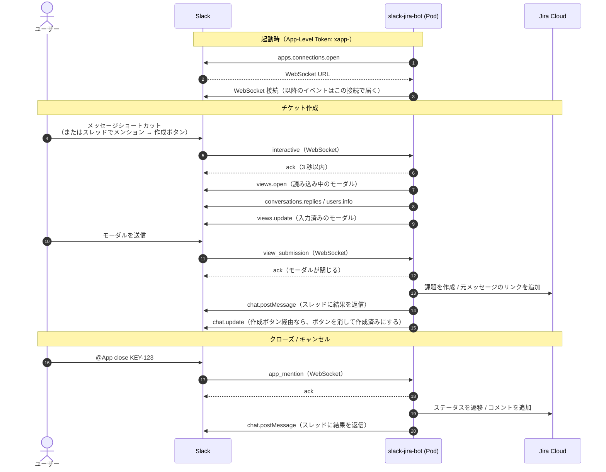

# slack-jira-bot (Go / Kubernetes)

Slack（Socket Mode）から Jira Cloud のチケットを作成・クローズ/キャンセルするアプリの Go 版です。

## リクエストの流れ

Socket Mode では、アプリ（Pod）から Slack へ WebSocket を張り、イベントはその接続で受け取ります。
公開エンドポイントは不要で、Slack・Jira への通信はすべて Pod からの外向き通信です。



- 受信は WebSocket 経由です。Slack の Web API（`views.open` や `chat.postMessage` など）は Bot Token（`xoxb-`）を使った HTTPS で呼びます。
- 受け取ったイベントには、まず 3 秒以内に ack を返し、その後で処理します。Jira の呼び出しなど時間のかかる処理は ack の後に行います。
- 複数の Pod がそれぞれ接続していても、1 つのイベントはどれか 1 つの Pod にだけ届きます。モーダルを開いた Pod と送信を受ける Pod が別になることがあるため、状態は Pod に持たず、モーダルの `private_metadata` に入れています。
- `trigger_id` は 3 秒で失効します。そのため、先に読み込み中のモーダルを開き、元メッセージの取得が終わってから中身を差し替えています。

## 構成

```text
cmd/slack-jira-bot/   エントリポイント（起動・ヘルスチェック・graceful shutdown）
internal/
  config/             環境変数の読み込み、許可リスト
  inquiry/            問い合わせ本文の解析（Slack SDK 非依存）
  jira/               Jira Cloud REST API クライアント
  slackapp/           Slack（Socket Mode）のイベント処理、モーダル
  textutil/           文字列の小さなユーティリティ
k8s/                  kustomize 一式（Deployment 2 replicas, PDB, NetworkPolicy, ConfigMap 生成）
Dockerfile            distroless/nonroot の最終イメージ
```

テストは Go の慣習どおり、対象と同じディレクトリに `*_test.go` として置いています。

```sh
go test ./...                    # 全パッケージのテスト
go build ./cmd/slack-jira-bot    # ビルド
```

## CI

GitHub Actions（[.github/workflows/ci.yml](.github/workflows/ci.yml)）と GitLab CI/CD（[.gitlab-ci.yml](.gitlab-ci.yml)）で、同じチェックを行います。片方を変えたら、もう片方も揃えてください。

| ジョブ | 内容 |
| --- | --- |
| `test` | `gofmt` / `go mod tidy -diff` / `go vet` / `go test -race` / Linux 向けビルド |
| `vulncheck` | `govulncheck` による既知の脆弱性のチェック |

- GitHub Actions は `main` への push・Pull Request・週 1 回の定期実行で動きます。GitLab は MR・デフォルトブランチへの push と、「Build > Pipeline schedules」で設定した定期実行で動きます。
- 依存関係（Go モジュール・GitHub Actions・Docker のベースイメージ）は Dependabot が週 1 回更新 PR を作ります（[.github/dependabot.yml](.github/dependabot.yml)）。
- Go のバージョンは Dockerfile・両 CI の 3 か所で指定しています（Dependabot の対象外）。上げるときはまとめて更新してください。
- 改行コードは [.gitattributes](.gitattributes) で LF に統一しています。

## 検証状況
slack-go v0.30.1 + Go 1.27.2 で `go mod tidy` / `go vet` / `go build` / `go test` が通ることを確認済みです。
実際の Slack ワークスペースとの結合動作（ショートカット、モーダル、メンション）は未確認です。
go.mod の `go 1.27.0` は最低バージョンです。Go を更新する場合は Dockerfile のベースイメージ（`golang:1.27-trixie`）も合わせて更新してください。
slack-go は 1.0 未満で、マイナーバージョンでも破壊的変更が入ることがあります。更新時はリリースノートの Breaking changes を確認してください。

## Slack App の設定

[Slack API](https://api.slack.com/apps) で「Create New App」→「From a manifest」を選び、次のマニフェストを貼り付けます（名前は自由に変えてください）。

```yaml
display_information:
  name: Jira Ticket Bot
features:
  bot_user:
    display_name: jira-ticket-bot
    always_online: true
  shortcuts:
    - name: Jira チケットを作成
      type: message
      callback_id: create_jira_ticket # コードの callbackID と一致させる
      description: このメッセージから Jira チケットを作成します
oauth_config:
  scopes:
    bot:
      - app_mentions:read # メンション（app_mention イベント）の受信
      - chat:write        # スレッドへの返信、作成ボタンの投稿・更新
      - commands          # メッセージショートカット
      - channels:history  # 作成ボタンから元メッセージを取得（公開チャンネル）
      - groups:history    # 同上（プライベートチャンネル）
      - users:read        # メンションを表示名に置き換える
      - users:read.email  # Slack ユーザーと Jira ユーザーをメールで対応付ける
settings:
  event_subscriptions:
    bot_events:
      - app_mention
  interactivity:
    is_enabled: true
  socket_mode_enabled: true
```

作成後に次の 2 つを行います。

1. 「Basic Information」→「App-Level Tokens」で、スコープ `connections:write` のトークンを発行します。これが `SLACK_APP_TOKEN`（`xapp-`）です。
2. ワークスペースにインストールし、「OAuth & Permissions」の Bot User OAuth Token を控えます。これが `SLACK_BOT_TOKEN`（`xoxb-`）です。

Bot は、使うチャンネルに招待しておいてください（`/invite @jira-ticket-bot`）。

## Jira の準備

- **API トークン**：チケットを作成するアカウント（サービスアカウント推奨）で発行します。スコープ付きトークンの場合、`JIRA_API_BASE` は `https://api.atlassian.com/ex/jira/<cloudId>` です。cloudId は `https://<your-domain>.atlassian.net/_edge/tenant_info` で確認できます。
- **課題タイプ ID**：`GET /rest/api/3/issuetype/project?projectId=<id>` などで確認します。
- **遷移 ID**（close / cancel を使う場合）：対象プロジェクトの課題で `GET /rest/api/3/issue/<KEY>/transitions` を呼んで確認します。遷移画面に「解決状況」がある場合は、`JIRA_*_RESOLUTION` に解決状況の名前を設定します。
- **優先度**：Jira 側の優先度名が `Highest` / `High` / `Medium` / `Low` であることを確認します。異なる場合は [internal/jira/client.go](internal/jira/client.go) の `priorityMap` を合わせてください。
- **報告者**：報告者を問い合わせ者にしたい場合は、サービスアカウントに「報告者の変更」権限を付けたうえで `JIRA_SET_REPORTER=1` にします。

## 環境変数

| 変数 | 必須 | 説明 |
| --- | --- | --- |
| `SLACK_BOT_TOKEN` | ✓ | Bot User OAuth Token（`xoxb-`） |
| `SLACK_APP_TOKEN` | ✓ | App-Level Token（`xapp-`、`connections:write`） |
| `ALLOWED_USER_IDS` | ✓ | 操作を許可する Slack ユーザー ID（カンマ区切り）。全員許可は `*` |
| `JIRA_BASE_URL` | ✓ | チケット URL の表示用（`https://<your-domain>.atlassian.net`） |
| `JIRA_API_BASE` | ✓ | API の呼び出し先（スコープ付きトークンは `https://api.atlassian.com/ex/jira/<cloudId>`） |
| `JIRA_EMAIL` | ✓ | API トークンを発行したアカウントのメールアドレス |
| `JIRA_API_TOKEN` | ✓ | Jira の API トークン |
| `JIRA_PROJECT_KEY` | ✓ | チケットを作成するプロジェクトのキー。close / cancel もこのプロジェクトだけが対象 |
| `JIRA_ISSUE_TYPE_ID` | ✓ | 作成する課題タイプの ID |
| `JIRA_SET_REPORTER` | | `1` で報告者を問い合わせ者にする（既定は設定しない） |
| `JIRA_CLOSE_TRANSITION_ID` / `JIRA_CANCEL_TRANSITION_ID` | | close / cancel で実行する遷移の ID。未設定だとそのコマンドは使えない |
| `JIRA_CLOSE_RESOLUTION` / `JIRA_CANCEL_RESOLUTION` | | 遷移時に設定する解決状況の名前 |
| `HTTP_ADDR` | | ヘルスチェックの待ち受けアドレス（既定 `:8080`） |

トークン類（`SLACK_BOT_TOKEN`・`SLACK_APP_TOKEN`・`JIRA_API_TOKEN`）は Secret に、それ以外は `k8s/config.env`（ConfigMap）に置きます。

## ローカルでの実行

Socket Mode なので、トンネル（ngrok など）は不要です。

```sh
export SLACK_BOT_TOKEN=xoxb-... SLACK_APP_TOKEN=xapp-... ALLOWED_USER_IDS=U012ABC
export JIRA_BASE_URL=https://<your-domain>.atlassian.net JIRA_API_BASE=https://api.atlassian.com/ex/jira/<cloudId>
export JIRA_EMAIL=... JIRA_API_TOKEN=... JIRA_PROJECT_KEY=... JIRA_ISSUE_TYPE_ID=...
go run ./cmd/slack-jira-bot
```

本番と同じ Slack App のトークンで起動すると、イベントがローカルと本番の Pod に分散して届きます。動作確認には別の Slack App（開発用）を使ってください。

## デプロイ手順

1. イメージをビルドして、コンテナレジストリ（Artifact Registry など）へ push します。タグはリリースごとに変えます（`latest` は使いません）。
2. `k8s/kustomization.yaml` の `images` を、実際のイメージとタグ（またはダイジェスト）に変更します。
3. `k8s/config.env` を編集します。
   - `ALLOWED_USER_IDS` は必須です（例: `U012ABC,U034DEF`）。全員に許可する場合は `*` を明示してください。未設定のままだと設定エラーで起動しません。
4. Secret を作成します。

   ```sh
   kubectl create ns slack-jira-bot
   cp k8s/secret.example.yaml k8s/secret.yaml  # 値を記入（Git にはコミットしない）
   kubectl apply -f k8s/secret.yaml
   ```

5. `kubectl apply -k k8s` で適用します。

## 通信要件
Egress 443 で `slack.com` / `*.slack.com`（WebSocket 含む）/ `api.atlassian.com` に到達できること。Ingress は不要です。

## ライセンス

[MIT License](LICENSE)
