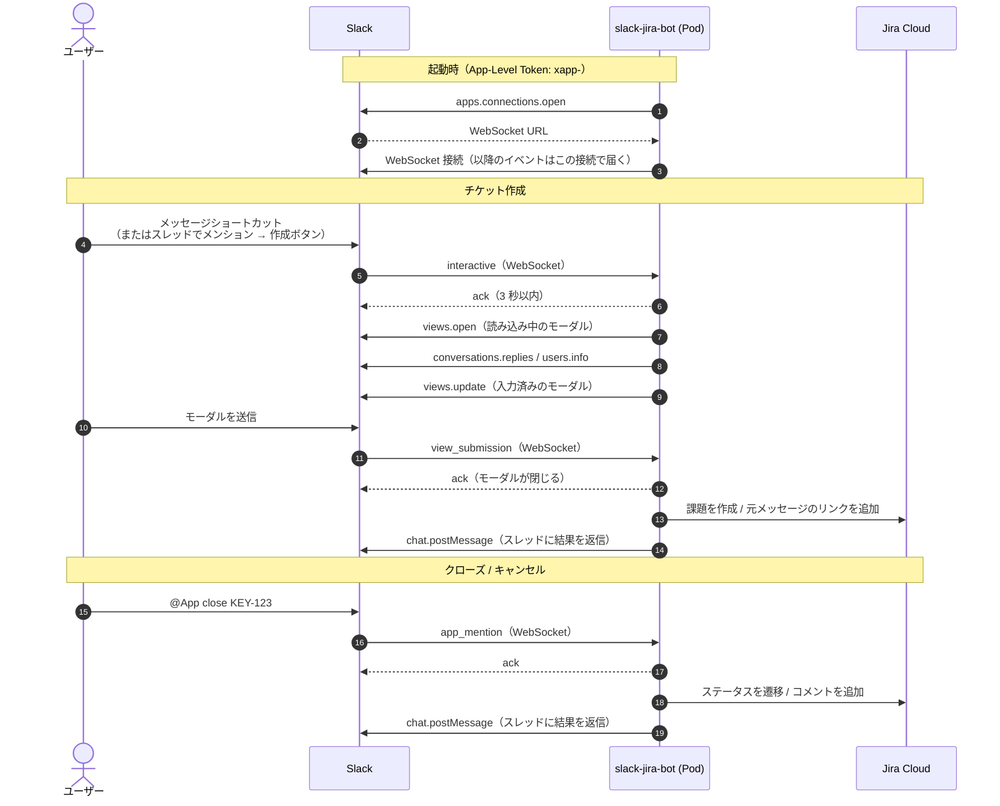

# slack-jira-bot (Go / Kubernetes)

Slack（Socket Mode）から Jira Cloud のチケットを作成・クローズ/キャンセルするアプリの Go 版です。

## リクエストの流れ

Socket Mode では、アプリ（Pod）から Slack へ WebSocket を張り、イベントはその接続で受け取ります。
公開エンドポイントは不要で、Slack・Jira への通信はすべて Pod からの外向き通信です。



- 受信は WebSocket 経由です。Slack の Web API（`views.open` や `chat.postMessage` など）は Bot Token（`xoxb-`）を使った HTTPS で呼びます。
- 受け取ったイベントには、まず 3 秒以内に ack を返し、その後で処理します。Jira の呼び出しなど時間のかかる処理は ack の後に行います。
- 複数の Pod がそれぞれ接続していても、1 つのイベントはどれか 1 つの Pod にだけ届きます。モーダルを開いた Pod と送信を受ける Pod が別になることがあるため、状態は Pod に持たず、モーダルの `private_metadata` に入れています。
- `trigger_id` は 3 秒で失効します。そのため、先に読み込み中のモーダルを開き、元メッセージの取得が終わってから中身を差し替えています。

## 構成

```text
cmd/slack-jira-bot/   エントリポイント（起動・ヘルスチェック・graceful shutdown）
internal/
  config/             環境変数の読み込み、許可リスト
  inquiry/            問い合わせ本文の解析（Slack SDK 非依存）
  jira/               Jira Cloud REST API クライアント
  slackapp/           Slack（Socket Mode）のイベント処理、モーダル
  textutil/           文字列の小さなユーティリティ
k8s/                  kustomize 一式（Deployment 2 replicas, PDB, NetworkPolicy, ConfigMap 生成）
Dockerfile            distroless/nonroot の最終イメージ
```

テストは Go の慣習どおり、対象と同じディレクトリに `*_test.go` として置いています。

```sh
go test ./...                    # 全パッケージのテスト
go build ./cmd/slack-jira-bot    # ビルド
```

## 検証状況
slack-go v0.30.1 + Go 1.27.2 で `go mod tidy` / `go vet` / `go build` / `go test` が通ることを確認済みです。
実際の Slack ワークスペースとの結合動作（ショートカット、モーダル、メンション）は未確認です。
go.mod の `go 1.27.0` は最低バージョンです。Go を更新する場合は Dockerfile のベースイメージ（`golang:1.27-trixie`）も合わせて更新してください。
slack-go は 1.0 未満で、マイナーバージョンでも破壊的変更が入ることがあります。更新時はリリースノートの Breaking changes を確認してください。

## デプロイ手順
1. go.mod / go.sum をそのままコミット（生成済み）
2. イメージをビルドして Artifact Registry へ push
3. `k8s/config.env` を編集、`k8s/kustomization.yaml` の `images` を実イメージに変更
   - `ALLOWED_USER_IDS` は必須です（例: `U012ABC,U034DEF`）。全員に許可する場合は `*` を明示してください。
     未設定のままだと設定エラーで起動しません。
4. Secret を作成:
       kubectl create ns slack-jira-bot
       cp k8s/secret.example.yaml k8s/secret.yaml  # 値を記入
       kubectl apply -f k8s/secret.yaml
5. `kubectl apply -k k8s`

## 通信要件
Egress 443 で `slack.com` / `*.slack.com`（WebSocket 含む）/ `api.atlassian.com` に到達できること。Ingress は不要です。

## ライセンス

[MIT License](LICENSE)
